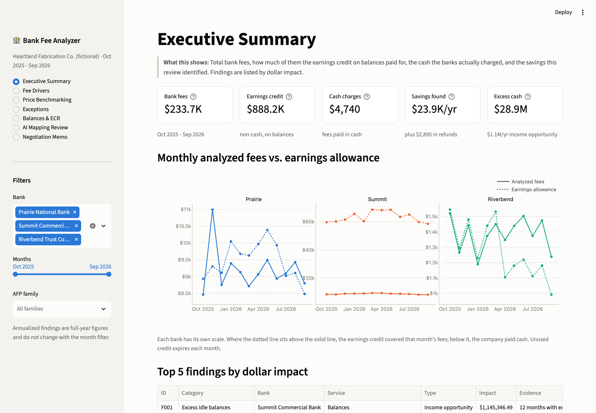
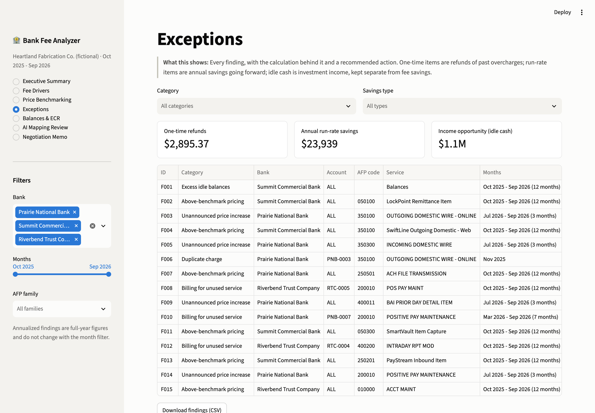
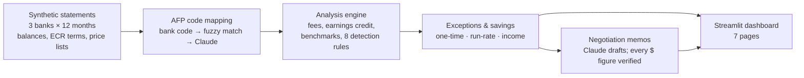

# Bank Fee Analyzer

**An AI-assisted review of a year of bank account analysis statements: it finds overcharges, benchmarks prices, checks earnings credits, and drafts the negotiation memo.**

**▶ [Open the live dashboard](https://bank-fee-analyzer-sinbbrau42siubj8nphcat.streamlit.app/)** (no sign-in needed)

> All companies, banks, and data are fictional. Benchmark prices are illustrative, not market survey data.

## The business problem

Bank fees are one of the larger controllable costs in a treasury department, yet the monthly **account analysis statement** is hard to read. Each bank uses its own service names, prices change without notice, earnings credits offset some fees but not others, and few teams check the statements line by line. Most mistakes go unnoticed.

This project reviews 12 months of statements (Oct 2025 – Sep 2026) for **Heartland Fabrication Co.**, a fictional $600M Midwest manufacturer with 25 accounts at three banks.

## Results

| | |
|---|---|
| Annual bank fees reviewed | **$233,722** (1,998 statement lines, 3 banks) |
| Annual fee savings identified | **$23,939 a year** going forward (about 10% of fees) |
| One-time refunds to request | **$2,895** (duplicates, a wrong pricing tier, math errors) |
| Idle cash that could be invested | **$28.6M** at Summit, worth about **$1.15M a year** at a 4% money market yield |
| Fee descriptions mapped to AFP codes | **61**, including 12 non-standard names mapped by Claude (12 of 12 correct, 2 flagged for review) |

**Three key findings**

1. **$28.6M of idle cash at the lockbox bank.** Summit holds an average of $33.3M but needs only $4.7M to offset its fees. Moving the excess into a money market fund or sweep would earn about $1.15M a year. It would also cut the FDIC assessment Summit charges on the full balance, Summit's single largest fee.
2. **Unannounced price increases at the primary bank.** In July 2026, Prairie raised six services by 13–18%, including outgoing wires ($11.29 → $12.76) and incoming wires ($11.78 → $13.87). Its price schedule still showed the old prices. Rolling them back is worth **$8,343 a year**.
3. **Above-benchmark pricing, mostly at Summit.** Eight services are priced above the illustrative 75th percentile, for example outgoing wires at $30, twice the median, and lockbox items at $0.58 against a $0.45 p75. Bringing them to p75 saves **$12,128 a year**.

Also found:
- four monthly modules billed with no related activity ($3,113 a year)
- duplicate wire charges ($2,168 refund)
- ACH credits billed at the wrong volume tier ($597 refund)
- two billing math errors ($130 refund)
- an ECR cut at Riverbend that turned covered fees into cash charges

Every finding shows its own calculation and a recommended action.

## Screenshots





More pages: [price benchmarking](docs/screenshot_benchmark.png) · [negotiation memo](docs/screenshot_memo.png)

## How it works



1. **Data** ([src/generate_data.py](src/generate_data.py)) builds a realistic year of statements with a fixed random seed. Each bank has its own price list and its own way of describing services (clean, abbreviated, or product names), and eight kinds of problem are planted in the data.
2. **AFP code mapping, AI feature #1** ([src/map_codes.py](src/map_codes.py)) gives each fee a standard AFP Service Code so prices can be compared across banks. Codes printed by the bank are used as-is. Close text matches are accepted. Claude (Haiku) maps the rest, using the description plus the account type, unit price, and volume, and anything it's unsure about is flagged for a person to review.
3. **Analysis** ([src/analyze.py](src/analyze.py)) works out each bank's monthly earnings credit, net cash charges, the balance needed to offset fees, and any excess balance. It then runs eight rules that rely only on the data: price increases, above-benchmark prices, unused services, duplicates, tier errors, math errors, ECR-driven shortfalls, and idle balances. Savings are counted in a fixed order so nothing is counted twice, and idle-cash income is always kept apart from fee savings.
4. **Negotiation memos, AI feature #2** ([src/memo.py](src/memo.py)) come from Claude, which receives a structured summary of one bank's findings and never the raw statement rows. It drafts a one-page memo for the Treasurer. Every dollar figure in the memo is then checked against that summary, and any figure that isn't there is flagged.
5. **The dashboard** ([app/streamlit_app.py](app/streamlit_app.py)) has seven pages:
   - executive summary
   - fee drivers
   - price benchmarking
   - exceptions, with a CSV download
   - balances and ECR, with what-if sliders
   - AI mapping review
   - negotiation memo

AI answers are cached, so the app runs with no API key and makes no AI calls. Tests (60) confirm every planted problem is detected with no false alarms, and check the earnings-credit math against hand calculations.

## Treasury concepts in brief

- **Account analysis statement:** the bank's monthly invoice for services. It lists each service, the volume, the unit price, and the charge, plus the company's balances and the earnings credit.
- **AFP Service Codes:** standard six-digit codes from the Association for Financial Professionals for bank services (e.g. 350100 = outgoing domestic wire). Banks use their own names, so mapping to AFP codes is what makes prices comparable across banks.
- **ECR (earnings credit rate):** the rate a bank applies to a company's balances to produce a non-cash credit that pays for fees. It isn't interest, and unused credit usually expires each month.
- **Earnings allowance:** the credit itself, worked out as:

  ```
  Earnings allowance = collected balance × (1 − reserve %) × ECR × days in month ÷ 365 (or 360)
  ```

  Fees above the allowance are paid in cash. If the ECR is cut, fees that used to be "free" become cash charges.
- **Balance required and excess balance:** the balance needed for the allowance to exactly cover fees. Anything above it earns nothing more, and could be invested instead.
- **ANSI X12 822 / ISO 20022 camt.086:** the standard electronic formats banks use to send account analysis data (822 in the U.S., camt.086 internationally). A real version of this tool would read these files instead of synthetic CSVs.

## Tech

Python 3.12 · pandas · Streamlit · Plotly · rapidfuzz · Anthropic API (Claude Haiku 5.5) · pytest. No database: inputs and outputs are CSV/JSON files on disk.

## How to run it

```bash
git clone <this repo> && cd bank-fee-analyzer
python3.12 -m venv .venv && source .venv/bin/activate
pip install -r requirements.txt
python run.py            # rebuild data → map codes → analyze → check memos → open the dashboard
pytest -q                # 60 tests
```

No API key is needed: AI mappings and memos are already cached in `data/cache/`. To let the app regenerate memos, copy `.env.example` to `.env` and add `ANTHROPIC_API_KEY`. Regenerating all three memos costs under one cent.

## Limitations

- **Synthetic data.** The company, banks, statements, and planted problems are all made up. Real statements are messier.
- **Illustrative benchmarks.** The price ranges are made up for demonstration. A real review would use a licensed survey or the company's own RFP results.
- **AFP code subset.** The tool uses 34 codes. The full AFP list is much longer and has to be licensed from AFP.
- **Real statements would need a parser.** Banks deliver account analysis as **X12 822** or **camt.086** files, or as PDFs. Any of these would plug in by converting them to the same statement-line table that `generate_data.py` produces; everything downstream stays the same.
- **Savings estimates are conservative.** Credits for past months at the higher prices, or for fees billed while services sat unused, are requested in the memos but not counted in the totals.
